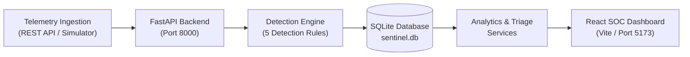

# SENTINEL AI — Cybersecurity Monitoring & Threat Investigation Platform

> **Version 1.0 (Foundation)**  
> A lightweight, modular Security Operations Centre (SOC) monitoring and threat detection platform built with Python, FastAPI, SQLite, React, Vite, and Tailwind CSS.

---

> [!IMPORTANT]
> **Synthetic Simulation Notice**:  
> In Version 1.0, all simulated attack scenarios and telemetry events are **100% synthetic**. They are generated safely in-memory and committed directly into the local SQLite database. **No actual network flooding, packet sniffing, or external network attacks are conducted.** Live operating system telemetry and VM monitoring are planned for future versions (V3.0).

---

## 1. Project Overview & Purpose

**Sentinel AI** is designed as a foundational Security Operations Centre (SOC) platform for real-time security log ingestion, deterministic rule-based threat detection, alert lifecycle management, and visual analytics. 

V1.0 establishes the core foundation:
- Ingestion of structured security telemetry logs via REST APIs.
- Instant threat evaluation through a modular, deterministic Detection Engine with 5 cybersecurity rules.
- Stateful alert deduplication to prevent alert fatigue during ongoing incidents.
- Interactive SOC dashboard for telemetry monitoring, alert triage, and visual analytics.
- Safe attack simulation engine for testing and demonstration without network risks.

---

## 2. Version 1.0 Features

- **High-Performance REST Backend**: Powered by FastAPI with asynchronous endpoints, automatic schema validation with Pydantic v2, and SQLite persistence via SQLAlchemy 2.0.
- **Deterministic Detection Engine**: Evaluates logs against 5 standard cyber defense rules with configurable sliding time windows.
- **Centralized Configuration**: All detection thresholds, time windows, and server parameters are configured in a central `.env` file rather than hardcoded in rules.
- **Intelligent Alert Deduplication**: Ongoing attacks from the same threat actor update the active incident's `trigger_count` and `updated_at` timestamp rather than creating duplicate alerts.
- **Interactive SOC Dashboard**:
  - **Overview**: Real-time KPI summary cards, severity distribution donut chart, 24-hour event timeline, top attacking IP rankings, and live alert feed.
  - **Live Logs**: Tabular security event stream with severity badges, event type filtering, live search, raw JSON inspector, pagination (25/50/100), and auto-refresh controls.
  - **Alert Centre**: Triage workflow allowing security analysts to filter alerts by status/severity and transition states (`NEW`, `INVESTIGATING`, `RESOLVED`, `FALSE_POSITIVE`).
  - **Simulation Centre**: One-click triggering of 8 realistic attack and traffic scenarios with customizable event counts.
- **Production-Ready Windows Scripts**: One-click `.bat` scripts to launch backend and frontend simultaneously or independently.

---

## 3. Architecture & Technology Stack

### System Architecture Flow



### Technology Stack

| Layer | Technologies | Purpose |
|---|---|---|
| **Backend Framework** | Python 3.11–3.14, FastAPI 0.110 | Asynchronous REST API server & Swagger documentation |
| **Data & ORM** | SQLite 3, SQLAlchemy 2.0 | Zero-configuration relational database and query layer |
| **Validation & Settings** | Pydantic v2, Pydantic-Settings | Strict request/response validation and environment config |
| **Frontend UI** | React 18, Vite 5, JavaScript (JSX) | Fast, responsive single-page Security Operations Center |
| **Styling & Icons** | Tailwind CSS 3, Lucide React | Dark cybersecurity SOC theme with responsive components |
| **Visualizations** | Recharts 2 | Time-series attack curves and severity distribution charts |
| **Testing** | Pytest 8, HTTPX | Automated unit, rule, API, and integration test suite |

---

## 4. Project Directory Structure

```
Sentinel-AI/
│
├── backend/                             # Python Backend Application
│   └── app/
│       ├── api/                         # REST API Route Controllers
│       │   ├── routes_alerts.py         # Alert triage & query endpoints
│       │   ├── routes_logs.py           # Log ingestion & retrieval endpoints
│       │   ├── routes_simulator.py      # Attack simulation endpoints
│       │   ├── routes_stats.py          # Dashboard analytics endpoints
│       │   └── __init__.py              # Central APIRouter registration (/api/v1)
│       ├── core/                        # Core Configuration & Logging
│       │   ├── config.py                # Centralized threshold & server settings
│       │   └── logging_config.py        # Structured logging configuration
│       ├── database/                    # Database Infrastructure
│       │   └── session.py               # SQLite engine, SessionLocal, and init_db()
│       ├── detection/                   # Core Threat Detection
│       │   ├── engine.py                # DetectionEngine & deduplication logic
│       │   └── rules.py                 # 5 Modular detection rules
│       ├── models/                      # SQLAlchemy Database Models
│       │   ├── alert.py                 # Alert incident ORM model
│       │   ├── rule.py                  # DetectionRule ORM model
│       │   └── security_log.py          # SecurityLog ORM model
│       ├── schemas/                     # Pydantic v2 Request/Response Schemas
│       │   ├── alert.py                 # Alert validation schemas
│       │   ├── log.py                   # SecurityLog validation schemas
│       │   ├── simulator.py             # Simulation request/response schemas
│       │   └── stats.py                 # Dashboard metrics schemas
│       ├── services/                    # Business Logic Layer
│       │   ├── alert_service.py         # Alert querying and lifecycle state updates
│       │   ├── log_service.py           # Log ingestion & rule evaluation triggers
│       │   ├── simulator_service.py     # Simulation execution & persistence
│       │   └── stats_service.py         # Aggregation of SOC metrics
│       ├── simulator/                   # Synthetic Telemetry Generator
│       │   └── generator.py             # 8 Predefined attack & benign generators
│       └── main.py                      # Application lifespan, CORS, and entrypoint
│
├── frontend/                            # React SOC Dashboard
│   ├── src/
│   │   ├── components/                  # Reusable UI Components
│   │   │   ├── Navbar.jsx               # Top navigation bar & live clock
│   │   │   ├── SeverityBadge.jsx        # Colored severity pill badges
│   │   │   ├── StatCard.jsx             # Metric counter cards
│   │   │   └── StatusBadge.jsx          # Alert lifecycle status badges
│   │   ├── pages/                       # Dashboard Views
│   │   │   ├── AlertsPage.jsx           # Alert investigation & triage table
│   │   │   ├── Dashboard.jsx            # SOC Overview & Recharts visual analytics
│   │   │   ├── LogsPage.jsx             # Live security log stream & JSON viewer
│   │   │   └── SimulatorPage.jsx        # Interactive scenario trigger panel
│   │   ├── services/
│   │   │   └── api.js                   # Unified frontend API client
│   │   ├── App.jsx                      # App root with tab-based navigation
│   │   ├── index.css                    # Tailwind CSS directives & theme styles
│   │   └── main.jsx                     # React DOM bootstrap
│   ├── package.json                     # Frontend dependencies & scripts
│   ├── tailwind.config.js               # Dark SOC color palette configuration
│   ├── vite.config.js                   # Vite configuration with backend proxy
│   └── .env.example                     # Frontend environment template
│
├── tests/                               # Comprehensive Automated Test Suite
│   ├── backend/
│   │   ├── test_api.py                  # API endpoint contract tests
│   │   ├── test_phase1_foundation.py    # Database, config, and schema tests
│   │   └── test_phase3_validation.py    # Integration, simulator, and triage tests
│   ├── detection/
│   │   ├── test_engine_deduplication.py # Stateful alert deduplication tests
│   │   ├── test_phase2_detection.py     # 5 Core rule logic & window tests
│   │   └── test_rules.py                # Dataset verification & false positive tests
│   └── conftest.py                      # In-memory SQLite fixture with StaticPool
│
├── docs/                                # Technical Documentation
│   ├── API_SPECIFICATION.md             # Complete REST API reference with schemas
│   ├── GITHUB_UPLOAD_GUIDE.md           # Beginner guide for GitHub web upload
│   └── SETUP_WINDOWS.md                 # Detailed Windows installation instructions
│
├── .env.example                         # Backend environment configuration template
├── .gitignore                           # Git ignore rules (excludes secrets/DB/node_modules)
├── requirements.txt                     # Pinned Python dependencies
├── start_backend.bat                    # One-click Windows backend launcher
├── start_frontend.bat                   # One-click Windows frontend launcher
└── start_sentinel.bat                   # One-click Windows joint system launcher
```

---

## 5. Prerequisites

Before running Sentinel AI on Windows, ensure the following are installed:

1. **Python**: Version **3.11, 3.12, 3.13, or 3.14** (64-bit).  
   *During installation, make sure to check the box: **"Add Python to PATH"**.*
2. **Node.js**: Version **18 or higher** (includes `npm`).  
   *Download the LTS installer from [nodejs.org](https://nodejs.org/).*
3. **Operating System**: Windows 10 or Windows 11.
4. **Shell**: Windows PowerShell or Command Prompt (`cmd.exe`).

Verify prerequisites in PowerShell:
```powershell
python --version
node --version
npm.cmd --version
```

---

## 6. Step-by-Step Windows Installation Instructions

### Step 1: Open Terminal in Project Directory
Open PowerShell and navigate to the project directory:
```powershell
cd C:\Users\DEBASIS\Documents\Sentinel-AI
```

### Step 2: Configure Environment Variables
Copy the template `.env.example` file to create your active `.env`:
```powershell
Copy-Item .env.example .env
Copy-Item frontend\.env.example frontend\.env
```

---

## 7. Virtual Environment & Dependency Installation

### Step 1: Set Up Backend Virtual Environment
```powershell
# Create virtual environment named 'venv'
python -m venv venv

# Activate the virtual environment
.\venv\Scripts\Activate.ps1

# Install pinned Python dependencies
pip install -r requirements.txt
```

> [!TIP]
> If PowerShell displays a script execution policy restriction error (`running scripts is disabled on this system`), run:
> ```powershell
> Set-ExecutionPolicy -Scope Process -ExecutionPolicy Bypass
> .\venv\Scripts\Activate.ps1
> ```
> Or use Command Prompt (`venv\Scripts\activate.bat`).

### Step 2: Install Frontend Dependencies
```powershell
cd frontend
npm.cmd install
cd ..
```

---

## 8. Database Initialization

Sentinel AI automatically creates and initializes the SQLite database schema (`sentinel.db`) upon server startup using FastAPI's lifespan event handler.

To verify or initialize the database manually:
```powershell
python -c "from backend.app.database.session import init_db; init_db()"
```
This ensures the `security_logs`, `alerts`, and `detection_rules` tables exist.

---

## 9. How to Start Backend and Frontend Separately

### Terminal 1: Start Backend API Server
```powershell
# Ensure virtual environment is active
.\venv\Scripts\Activate.ps1

# Start Uvicorn ASGI server
python -m uvicorn backend.app.main:app --host 127.0.0.1 --port 8000 --reload
```
The backend API is now running at `http://127.0.0.1:8000`.

### Terminal 2: Start Frontend SOC Dashboard
```powershell
cd frontend
npm.cmd run dev
```
The React SOC Dashboard is now accessible at `http://localhost:5173`.

---

## 10. How to Start the Complete Application Using Helper Scripts

For everyday use, convenient Windows batch scripts are provided in the project root:

- **Launch Both Simultaneously**:  
  Double-click **`start_sentinel.bat`** (or execute `.\start_sentinel.bat` in PowerShell).  
  This validates your environment and automatically opens the Backend Server and Frontend Dashboard in two distinct terminal windows.
- **Launch Backend Only**:  
  Double-click **`start_backend.bat`**.
- **Launch Frontend Only**:  
  Double-click **`start_frontend.bat`**.

---

## 11. Application URLs

| Service | URL | Description |
|---|---|---|
| **SOC Dashboard** | `http://localhost:5173` | Interactive visual dashboard, logs, triage, simulator |
| **Backend API** | `http://127.0.0.1:8000` | REST API service root |
| **Swagger UI** | `http://127.0.0.1:8000/docs` | Interactive Swagger API documentation & testing |
| **ReDoc UI** | `http://127.0.0.1:8000/redoc` | Structured technical API documentation |
| **Health Check** | `http://127.0.0.1:8000/health` | Service and SQLite health verification |

---

## 12. Available API Endpoints

All application routes are versioned under `/api/v1`:

| Method | Endpoint | Description |
|---|---|---|
| `GET` | `/health` | Service health status and database connectivity |
| `POST` | `/api/v1/logs` | Ingest a single log and evaluate detection rules |
| `POST` | `/api/v1/logs/batch` | Ingest multiple security logs in a batch |
| `GET` | `/api/v1/logs` | Query logs with pagination (`skip`, `limit`) and filters (`severity`, `event_type`, `search`) |
| `GET` | `/api/v1/alerts` | Query alerts with pagination and filters (`severity`, `status`, `search`) |
| `GET` | `/api/v1/alerts/{alert_id}` | Fetch detailed information for a specific alert |
| `PATCH` | `/api/v1/alerts/{alert_id}/status` | Update alert triage status (`NEW`, `INVESTIGATING`, `RESOLVED`, `FALSE_POSITIVE`) |
| `GET` | `/api/v1/stats` | Retrieve aggregated SOC statistics, timeline, severity breakdown, and top attackers |
| `POST` | `/api/v1/simulator/run` | Execute a synthetic attack or normal traffic simulation |

*For complete request/response JSON schemas, see [API_SPECIFICATION.md](file:///c:/Users/DEBASIS/Documents/Sentinel-AI/docs/API_SPECIFICATION.md).*

---

## 13. Detection Rules & Configurable Thresholds

All thresholds are centralized in `.env` and loaded by `backend/app/core/config.py`:

| Rule ID | Rule Name | Severity | Condition & Default Threshold |
|---|---|---|---|
| `RULE-AUTH-BRUTEFORCE` | Brute Force Authentication Detection | **HIGH** | $\ge 5$ failed authentication attempts (`AUTHENTICATION_FAILED`) from the same source IP within **60 seconds**. |
| `RULE-NET-PORTSCAN` | Port Scan Reconnaissance Detection | **HIGH** | Probes targeting $\ge 5$ distinct destination ports from the same source IP within **30 seconds**. |
| `RULE-AUTH-ROOT-LOGIN` | Unauthorized Remote Root Login | **CRITICAL** | Successful authentication (`AUTHENTICATION_SUCCESS`) for `root` or `administrator` from an external source IP. *(Note: Isolated failed root logins are recorded as telemetry logs but do not trigger a critical breach).* |
| `RULE-NET-DDOS-AGGREGATE` | Aggregate DDoS Traffic Spike | **CRITICAL** | $\ge 20$ aggregate network requests targeting the same destination IP within **30 seconds** originating from $\ge 3$ distinct source IPs. |
| `RULE-ANOMALOUS-SPIKE` | Anomalous Request Spike | **MEDIUM** | Volumetric burst of $\ge 20$ requests from a single source IP within **60 seconds**. |

---

## 14. Available Simulator Scenarios & Expected Outcomes

The synthetic simulator generates safe, deterministic telemetry to demonstrate detection capabilities:

| Scenario Key | Description | Expected Detection Outcome |
|---|---|---|
| `NORMAL_TRAFFIC` | Benign web traffic (GET/POST requests, HTTP 200/304, standard user logins). | Stored in SQLite. **Zero alerts triggered** (0 false alarms). |
| `BRUTE_FORCE` | Rapid sequence of failed SSH/web logins from a single attacker IP. | Triggers **`RULE-AUTH-BRUTEFORCE`** (HIGH severity alert). |
| `PORT_SCAN` | Sequential port probe scanning ports 21, 22, 80, 443, 8080, etc. | Triggers **`RULE-NET-PORTSCAN`** (HIGH severity alert). |
| `SUCCESSFUL_ROOT_LOGIN` | Remote SSH login achieving successful root/administrator privilege. | Triggers **`RULE-AUTH-ROOT-LOGIN`** (CRITICAL severity alert). |
| `FAILED_ROOT_LOGIN` | Remote SSH login attempt for root that fails password validation. | Stored as telemetry. **No critical alert triggered** (distinguished from successful breach). |
| `DDOS_ATTACK` | Distributed volumetric flood targeting a server IP from multiple botnet IPs. | Triggers **`RULE-NET-DDOS-AGGREGATE`** (CRITICAL severity alert). |
| `ANOMALOUS_SPIKE` | High-frequency API request burst from a single source IP. | Triggers **`RULE-ANOMALOUS-SPIKE`** (MEDIUM severity alert). |
| `MIXED` | Realistic blend of normal traffic interleaved with attack bursts. | Stores all logs; triggers alerts corresponding only to the malicious patterns. |

---

## 15. Automated Verification & Testing

### Running the Backend Test Suite
The backend is verified using `pytest`. The test suite covers configuration, database models, Pydantic schemas, detection rules, deduplication, and all API endpoints.

```powershell
python -m pytest -v
```
**Baseline Test Results**: **38 passed, 0 failed, 0 skipped** (Execution time: ~0.75s).

### Building the Frontend for Production
To verify that all JSX components, Tailwind styles, and dependencies compile cleanly:

```powershell
cd frontend
npm.cmd run build
```
**Build Results**: 2087 modules transformed, production assets compiled in `frontend/dist` with 0 errors.

---

## 16. Troubleshooting Common Errors

### 1. `File npm.ps1 cannot be loaded because running scripts is disabled`
- **Cause**: Windows PowerShell default execution policy blocks unsigned `.ps1` files.
- **Solution**: Use `npm.cmd` instead of `npm`, or execute:
  ```powershell
  Set-ExecutionPolicy -Scope Process -ExecutionPolicy Bypass
  ```

### 2. `Address already in use` (Port 8000 or 5173 occupied)
- **Cause**: A previous instance of Uvicorn or Vite is still running in the background.
- **Solution**: Find and stop the process using PowerShell:
  ```powershell
  # Find PID using port 8000
  netstat -ano | findstr :8000
  # Terminate process by PID
  taskkill /PID <PID> /F
  ```

### 3. `ModuleNotFoundError: No module named 'fastapi'`
- **Cause**: The Python virtual environment has not been activated.
- **Solution**: Activate `venv` prior to running python:
  ```powershell
  .\venv\Scripts\Activate.ps1
  ```

### 4. `Frontend dependencies are missing (node_modules directory not found)`
- **Cause**: `npm install` has not been executed inside the `frontend` folder.
- **Solution**:
  ```powershell
  cd frontend
  npm.cmd install
  cd ..
  ```

---

## 17. Current Limitations & Version Roadmap

### Version 1.0 (Foundation) Scope & Boundaries:
- **Rule-Based**: Threat detection relies strictly on deterministic threshold rules and sliding time windows.
- **Synthetic Simulation**: Telemetry is generated via the built-in simulator or ingested via REST API. Live kernel/network sniffing is not enabled in V1.0.
- **Local Storage**: Designed with SQLite for zero-configuration local deployment.

### Future Development Roadmap:
- **Version 1.5 — Machine Learning Anomaly Detection**:
  - Integration of scikit-learn Isolation Forest and clustering for zero-day traffic anomaly detection.
  - Adaptive baseline traffic modeling.
- **Version 2.0 — Google Gemma 4 Cloud API & Agentic AI**:
  - Autonomous Agentic AI incident investigation assistant.
  - LLM-assisted threat triage summaries and suggested mitigation playbooks using Google Gemma models.
- **Version 2.5 — Multi-Stage Attack Correlation & Cyber Threat Intelligence (CTI)**:
  - MITRE ATT&CK kill-chain mapping (Reconnaissance $\rightarrow$ Access $\rightarrow$ Lateral Movement).
  - External threat intelligence feed ingestion (abuse.ch, AlienVault OTX).
- **Version 3.0 — Production Monitoring & Virtual Machine Telemetry**:
  - Native Windows Event Log (ETW) and Linux Auditd live telemetry collectors.
  - Hypervisor / Virtual Machine isolation and automated network quarantine actions.

---

## 18. Manual GitHub Upload Checklist

For beginners uploading Sentinel AI V1.0 to GitHub through the website interface:

1. Refer to the step-by-step guide in [docs/GITHUB_UPLOAD_GUIDE.md](file:///c:/Users/DEBASIS/Documents/Sentinel-AI/docs/GITHUB_UPLOAD_GUIDE.md).
2. **Include**: `backend/`, `frontend/` (without `node_modules` and `dist`), `tests/`, `docs/`, `requirements.txt`, `.env.example`, `.gitignore`, `README.md`, and all `.bat` files.
3. **Exclude**: `venv/`, `frontend/node_modules/`, `frontend/dist/`, `.env`, `sentinel.db`, and `__pycache__/`.

---

## 19. License

This project is developed for educational, academic, and research purposes in cybersecurity and agentic artificial intelligence.

