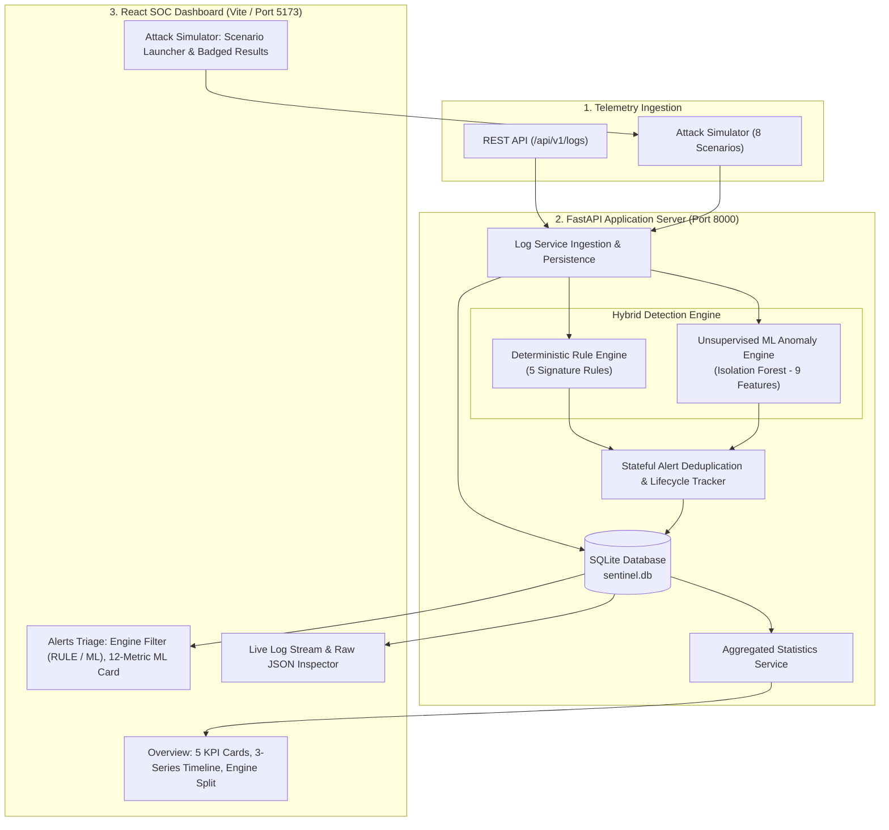

# SENTINEL AI — Cybersecurity Monitoring & Threat Investigation Platform
## 👥 Team Beatwise

**Project:** Sentinel AI V1.5 – Hybrid AI-Powered Cybersecurity Threat Detection and Monitoring System

We are Team Beatwise, a group of students working together to develop an intelligent cybersecurity monitoring platform that combines rule-based detection with machine-learning-based anomaly detection.

### Team Members

| S. No. | Name | Role |
|---|---|---|
| 1 | Biswaprakash Naik | Team Leader |
| 2 | Banshika Das | Team Member |
| 3 | Harishankar Pramanik | Team Member |
| 4 | Debasis Mohapatra | Team Member |

**Institution:** Sambalpur University Institute of Information Technology (SUIIT), Sambalpur, Odisha

**Team Name:** Beatwise
> **Version 1.5 (Hybrid Threat Detection & Machine Learning)**  
> A lightweight, modular Security Operations Centre (SOC) monitoring and threat detection platform combining deterministic cyber threat detection rules with unsupervised Machine Learning (Isolation Forest) anomaly scoring. Built with Python, FastAPI, SQLite, Scikit-learn, React, Vite, and Tailwind CSS.

---

> [!IMPORTANT]
> **Synthetic Simulation Notice**:  
> In Sentinel AI V1.5, all simulated attack scenarios and telemetry events are **100% synthetic**. They are generated safely in-memory and committed directly into the local SQLite database (`sentinel.db`). **No actual network flooding, packet sniffing, or external network attacks are conducted.** Live operating system telemetry (ETW / Auditd) and VM monitoring are planned for future versions (V3.0).

---

## 1. Project Overview & Purpose

**Sentinel AI V1.5** is an interactive Security Operations Centre (SOC) platform designed for real-time security log ingestion, hybrid threat detection, stateful alert lifecycle management, and visual analytics.

Version 1.5 advances the foundation by introducing a **Hybrid Threat Detection Engine**:
- **Continuous Log Ingestion**: Ingests structured security telemetry logs via REST APIs or the integrated synthetic telemetry simulator.
- **Dual-Engine Threat Evaluation**: Concurrently evaluates logs through:
  1. **Deterministic Rule Engine**: 5 high-fidelity cyber defense rules matching known attack patterns (brute-force, port scanning, unauthorized root logins, volumetric spikes, and distributed DDoS).
  2. **Unsupervised ML Anomaly Engine**: An Isolation Forest detector evaluating 9 canonical numerical features over sliding observation windows to flag macro-level statistical outliers.
- **Stateful Alert Deduplication**: Active incidents are deduplicated by threat entity and rule signature to prevent alert fatigue, incrementing hit counts while tracking incident progression.
- **Triage & Investigation Centre**: Provides an analyst-centric triage table with real-time text search, severity/status filtering, engine isolation (`RULE` vs `ML`), and a 12-metric telemetry explanation breakdown for ML anomalies.
- **Visual Analytics Dashboard**: Displays 5 operational KPI cards, a 3-series 60-minute threat timeline, an engine breakdown split bar, and a real-time incident feed.
- **Safe Attack Simulator**: Offers 8 realistic security scenarios demonstrating dual-engine evaluation and false-positive resilience without external network risk.

---

## 2. Version 1.5 Features & Highlights

- **High-Performance REST Backend**: Built on FastAPI with asynchronous request handling, strict Pydantic v2 validation, and SQLAlchemy 2.0 ORM with SQLite persistence.
- **Hybrid Detection Pipeline**:
  - Deterministic rules fire immediately on individual log thresholds.
  - The Isolation Forest model continuously monitors macroscopic feature distributions across a sliding 60-second window.
- **9 Canonical Numerical Features**:
  1. `total_events`: Volumetric activity count within the observation window.
  2. `failed_auth_count`: Number of authentication failures.
  3. `successful_auth_count`: Number of successful authentication sessions.
  4. `unique_source_ips`: Number of distinct originating client IPs.
  5. `unique_dest_ips`: Number of distinct destination hosts targeted.
  6. `unique_dest_ports`: Number of unique destination ports targeted.
  7. `event_frequency`: Events per second across the observation window.
  8. `avg_time_interval`: Average time gap (seconds) between consecutive events.
  9. `network_traffic_volume`: Total network byte volume transferred.
- **Explainable ML Telemetry**:
  - Automatically parses and presents the 12 key attributes of an ML alert: Model Version, Normalized Anomaly Score, Raw Decision Score, Decision Threshold, Total Events, Failed Auths, Unique Source IPs, Unique Destination IPs, Unique Destination Ports, Event Frequency, Average Time Interval, and Network Traffic Volume.
  - Includes a mandatory **Analyst Disclaimer**: *An ML anomaly indicates statistically unusual telemetry. It is not proof of malicious activity. The anomaly score is not a probability, and the model does not establish causal feature attribution.*
- **Zero Schema Migration (Strategy A)**:
  - Preserves full SQLite schema backwards compatibility: ML alerts use fixed `MEDIUM` severity, rule ID `RULE-ML-ANOMALY-IFOREST`, and structured descriptions.
- **Modular Failure Isolation**:
  - If the ML model artifact is missing or corrupt, `DetectionEngine` safely leaves ML detection dormant without crashing or impeding the 5 deterministic rules.
- **Interactive SOC Dashboard**:
  - **KPI Cards**: Total Logs, Active Threats, Critical Incidents, Resolved Threats, and ML Anomalies.
  - **3-Series Timeline**: Tracks Telemetry Logs, Rule-Based Alerts, and ML Anomalies across 10-minute intervals.
  - **Detection Engine Split**: Compares rule signatures vs statistical outliers with visual percentage bars.
  - **Detection Badges**: Distinct visual pills (`RULE-BASED` in cyan, `ML HEURISTIC` in purple) throughout Dashboard, Triage, and Simulator pages.
- **Production Windows Batch Scripts**: One-click scripts to launch backend and frontend simultaneously (`start_sentinel.bat`) or independently.

---

## 3. Architecture & Technology Stack

### Dual-Engine Pipeline Architecture



### Technology Stack

| Layer | Technologies | Purpose |
|---|---|---|
| **Backend Framework** | Python 3.12 (3.11–3.13), FastAPI 0.110 | Asynchronous REST API server & Swagger documentation |
| **Machine Learning** | Scikit-learn 1.4+, NumPy 1.26+, Joblib 1.4+ | Isolation Forest training, serialization, and numerical inference |
| **Data & ORM** | SQLite 3, SQLAlchemy 2.0 | Zero-configuration relational database and ORM query layer |
| **Validation & Settings** | Pydantic v2, Pydantic-Settings | Strict request/response validation and environment config |
| **Frontend UI** | React 18, Vite 5, JavaScript (JSX) | Fast, responsive single-page Security Operations Center |
| **Styling & Icons** | Tailwind CSS 3, Lucide React | Cyber dark SOC theme with responsive components |
| **Visualizations** | Recharts 2 | Time-series attack curves, engine split bar, and severity distribution |
| **Testing** | Pytest 8, HTTPX | 102 automated unit, rule, API, ML, and integration tests |

---

## 4. Project Directory Structure

```
Sentinel-AI-V1.5/
│
├── backend/                             # Python Backend Application
│   └── app/
│       ├── api/                         # REST API Route Controllers
│       │   ├── routes_alerts.py         # Alert triage & engine filtering (?engine=RULE|ML)
│       │   ├── routes_logs.py           # Log ingestion & retrieval endpoints
│       │   ├── routes_simulator.py      # Attack simulation endpoints
│       │   ├── routes_stats.py          # Dashboard analytics endpoints
│       │   └── __init__.py              # Central APIRouter registration (/api/v1)
│       ├── core/                        # Core Configuration & Logging
│       │   ├── config.py                # Centralized threshold & ML settings (v1.5.0)
│       │   └── logging_config.py        # Structured logging configuration
│       ├── database/                    # Database Infrastructure
│       │   └── session.py               # SQLite engine, SessionLocal, and init_db()
│       ├── detection/                   # Core Threat Detection
│       │   ├── engine.py                # DetectionEngine & deduplication logic
│       │   └── rules.py                 # 5 Deterministic rules + MLAnomalyRule
│       ├── ml/                          # Machine Learning Subsystem
│       │   ├── saved_models/            # Serialized model directory (.joblib)
│       │   │   └── .gitkeep             # Git keep file (joblib artifact is ignored)
│       │   ├── config.py                # ML hyperparameters and feature definitions
│       │   ├── evaluate.py              # ML evaluation CLI script
│       │   ├── evaluation.py            # Diagnostic metric calculation utilities
│       │   ├── features.py              # 9-feature extraction from SecurityLog windows
│       │   ├── model.py                 # IsolationForestModel wrapper class
│       │   ├── model_store.py           # Safe Joblib model persistence & schema validation
│       │   ├── preprocessing.py         # Pure NumPy matrix sanitization & validation
│       │   ├── train.py                 # Offline model training CLI script
│       │   └── training_data.py         # Synthetic normal baseline data generator
│       ├── models/                      # SQLAlchemy Database Models
│       │   ├── alert.py                 # Alert incident ORM model
│       │   ├── rule.py                  # DetectionRule ORM model
│       │   └── security_log.py          # SecurityLog ORM model
│       ├── schemas/                     # Pydantic v2 Request/Response Schemas
│       │   ├── alert.py                 # Alert validation schemas
│       │   ├── log.py                   # SecurityLog validation schemas
│       │   ├── simulator.py             # Simulation request/response schemas
│       │   └── stats.py                 # Extended dashboard metrics schemas
│       ├── services/                    # Business Logic Layer
│       │   ├── alert_service.py         # Alert querying and engine filtering
│       │   ├── log_service.py           # Log ingestion & hybrid rule evaluation
│       │   ├── simulator_service.py     # Simulation execution & persistence
│       │   └── stats_service.py         # Aggregated SOC metrics & timeline query
│       ├── simulator/                   # Synthetic Telemetry Generator
│       │   └── generator.py             # 8 Predefined attack & benign generators
│       └── main.py                      # Application lifespan, CORS, and entrypoint
│
├── frontend/                            # React SOC Dashboard
│   ├── src/
│   │   ├── components/                  # Reusable UI Components
│   │   │   ├── DetectionBadge.jsx       # Visual distinction pill (RULE-BASED vs ML HEURISTIC)
│   │   │   ├── Navbar.jsx               # Navigation bar with AI v1.5 branding
│   │   │   ├── SeverityBadge.jsx        # Colored severity pill badges
│   │   │   ├── StatCard.jsx             # Metric counter cards (cyan, amber, red, emerald, purple)
│   │   │   └── StatusBadge.jsx          # Alert lifecycle status badges
│   │   ├── pages/                       # Dashboard Views
│   │   │   ├── AlertsPage.jsx           # Triage table with engine filter & 12-metric ML card
│   │   │   ├── Dashboard.jsx            # SOC Overview, 3-series timeline & engine split bar
│   │   │   ├── LogsPage.jsx             # Live security log stream & JSON viewer
│   │   │   └── SimulatorPage.jsx        # Scenario trigger panel with badged result cards
│   │   ├── services/
│   │   │   └── api.js                   # Unified frontend API client
│   │   ├── App.jsx                      # App root with v1.5 footer
│   │   ├── index.css                    # Tailwind CSS directives & theme styles
│   │   └── main.jsx                     # React DOM bootstrap
│   ├── package.json                     # Frontend dependencies (v1.5.0)
│   ├── tailwind.config.js               # Dark SOC color palette configuration
│   ├── vite.config.js                   # Vite configuration with backend proxy
│   └── .env.example                     # Frontend environment template
│
├── tests/                               # Comprehensive Automated Test Suite (102 Tests)
│   ├── backend/
│   │   ├── test_api.py                  # API endpoint, stats aggregation, and engine filter tests
│   │   ├── test_phase1_foundation.py    # Database, config, and schema tests
│   │   └── test_phase3_validation.py    # Integration, simulator, and triage tests
│   ├── detection/
│   │   ├── test_engine_deduplication.py # Stateful alert deduplication tests
│   │   ├── test_hybrid_detection_engine.py # Hybrid dual-engine integration tests
│   │   ├── test_ml_rule_detection.py    # MLAnomalyRule threshold & attribution tests
│   │   ├── test_phase2_detection.py     # Deterministic rule logic & window tests
│   │   └── test_rules.py                # Dataset verification & false positive tests
│   ├── ml/
│   │   ├── test_ml_evaluation.py        # Model evaluation & metrics tests
│   │   ├── test_ml_features.py          # 9-feature extraction unit tests
│   │   ├── test_ml_model.py             # IsolationForest model persistence & prediction tests
│   │   └── test_ml_preprocessing.py      # Feature matrix validation tests
│   └── conftest.py                      # In-memory SQLite fixture with StaticPool
│
├── docs/                                # Technical Documentation
│   ├── API_SPECIFICATION.md             # Complete REST API reference with schemas
│   ├── GITHUB_UPLOAD_GUIDE.md           # Beginner guide for GitHub upload
│   ├── HYBRID_DETECTION_ENGINE.md       # Comprehensive hybrid detection architecture guide
│   ├── ISOLATION_FOREST.md              # Model architecture and training specifications
│   ├── ML_EVALUATION.md                 # Evaluation benchmarks and validation results
│   ├── ML_FEATURE_ENGINEERING.md        # Mathematical feature definitions
│   └── SETUP_WINDOWS.md                 # Detailed Windows installation instructions
│
├── .env.example                         # Backend environment configuration template (v1.5.0)
├── .gitignore                           # Git ignore rules (excludes secrets/DB/joblib)
├── requirements.txt                     # Pinned Python dependencies
├── start_backend.bat                    # One-click Windows backend launcher (v1.5)
├── start_frontend.bat                   # One-click Windows frontend launcher (v1.5)
└── start_sentinel.bat                   # One-click Windows joint system launcher (v1.5)
```

---

## 5. Prerequisites

Before running Sentinel AI V1.5 on Windows, verify that the following tools are installed:

1. **Python**: Version **3.12** recommended (Python 3.11–3.13, 64-bit supported).  
   *During installation, check the box: **"Add Python to PATH"**.*
2. **Node.js**: Version **18 or higher** (includes `npm`).  
   *Download LTS from [nodejs.org](https://nodejs.org/).*
3. **Operating System**: Windows 10 or Windows 11 (x64).
4. **Shell**: Windows PowerShell or Command Prompt (`cmd.exe`).

Verify prerequisites in PowerShell:
```powershell
python --version
node --version
npm.cmd --version
```

---

## 6. Fresh Windows Installation & Setup Guide

### Critical Model Setup Requirement
> [!IMPORTANT]
> The trained ML model artifact (`isolation_forest.joblib`) is **intentionally excluded from Git** via `.gitignore` to keep the repository lightweight and binary-free.
>
> **A fresh clone must train the model locally prior to running hybrid detection.** If started without training, deterministic detection remains operational, while ML detection stays dormant until a trained model is available.

### Step 1: Open PowerShell in Project Directory
```powershell
cd C:\Users\DEBASIS\Documents\Sentinel-AI-V1.5
```

### Step 2: Configure Environment Variables
Copy the template `.env.example` files:
```powershell
Copy-Item .env.example .env
Copy-Item frontend\.env.example frontend\.env
```

### Step 3: Set Up Python Virtual Environment & Install Dependencies
```powershell
Set-ExecutionPolicy -Scope Process -ExecutionPolicy Bypass
python -m venv venv
.\venv\Scripts\Activate.ps1
python -m pip install -r requirements.txt
```

### Step 4: Train the Production ML Model
Execute the offline training CLI script:
```powershell
python -m backend.app.ml.train
```
*Output*: Generates the validated model bundle at `backend/app/ml/saved_models/isolation_forest.joblib` in under 2 seconds.

### Step 5: Install Frontend Dependencies
```powershell
cd frontend
npm.cmd install
cd ..
```

---

## 7. Starting the Application

### Option A: Complete Application (Joint Launcher — Recommended)
Double-click **`start_sentinel.bat`** (or execute `.\start_sentinel.bat` in PowerShell).  
This automatically opens the Backend API Server and Frontend SOC Dashboard in two distinct terminal windows.

### Option B: Starting Services Independently

#### Terminal 1: Backend API Server
```powershell
.\venv\Scripts\Activate.ps1
python -m uvicorn backend.app.main:app --host 127.0.0.1 --port 8000 --reload
```
API runs at `http://127.0.0.1:8000`.

#### Terminal 2: Frontend SOC Dashboard
```powershell
cd frontend
npm.cmd run dev
```
Dashboard runs at `http://localhost:5173`.

---

## 8. Application URLs

| Service | URL | Description |
|---|---|---|
| **SOC Dashboard** | `http://localhost:5173` | Interactive visual dashboard, logs, triage, and simulator |
| **Backend API** | `http://127.0.0.1:8000` | REST API service root |
| **Swagger UI** | `http://127.0.0.1:8000/docs` | Interactive Swagger API documentation & testing |
| **ReDoc UI** | `http://127.0.0.1:8000/redoc` | Structured technical API documentation |
| **Health Check** | `http://127.0.0.1:8000/health` | Service and SQLite health verification |

---

## 9. Available API Endpoints

All API routes are versioned under `/api/v1`:

| Method | Endpoint | Description |
|---|---|---|
| `GET` | `/health` | Service health status and SQLite connectivity |
| `POST` | `/api/v1/logs` | Ingest a single log and evaluate through active detection rules |
| `POST` | `/api/v1/logs/batch` | Ingest multiple security logs in a batch |
| `GET` | `/api/v1/logs` | Query logs with pagination (`skip`, `limit`) and filters (`severity`, `event_type`, `search`) |
| `GET` | `/api/v1/alerts` | Query alerts with pagination and filters (`severity`, `status`, `search`, and **`engine=RULE\|ML`**) |
| `GET` | `/api/v1/alerts/{alert_id}` | Fetch detailed information for a specific alert |
| `PATCH` | `/api/v1/alerts/{alert_id}/status` | Update triage status (`NEW`, `INVESTIGATING`, `RESOLVED`, `FALSE_POSITIVE`) |
| `GET` | `/api/v1/stats` | Retrieve aggregated metrics (`total_logs`, `active_alerts`, `ml_alerts`, `rule_alerts`, timeline) |
| `POST` | `/api/v1/simulator/run` | Execute a synthetic attack or normal traffic simulation |

*For complete schemas, see [docs/API_SPECIFICATION.md](file:///c:/Users/DEBASIS/Documents/Sentinel-AI-V1.5/docs/API_SPECIFICATION.md).*

---

## 10. Threat Detection Engine Specifications

### A. Five Deterministic Detection Rules

Configured in `.env` and loaded via `backend/app/core/config.py`:

| Rule ID | Rule Name | Severity | Condition & Default Threshold |
|---|---|---|---|
| `RULE-AUTH-BRUTEFORCE` | Brute Force Authentication Detection | **HIGH** | $\ge 5$ failed attempts (`AUTHENTICATION_FAILED`) from same source IP within **60 seconds**. |
| `RULE-NET-PORTSCAN` | Port Scan Reconnaissance Detection | **MEDIUM** | Probes targeting $\ge 5$ distinct destination ports from same source IP within **30 seconds**. |
| `RULE-AUTH-ROOT-LOGIN` | Unauthorized Remote Root Login | **CRITICAL** | Successful authentication for `root` or `administrator` from an external source IP. |
| `RULE-NET-DDOS-AGGREGATE` | Aggregate DDoS Traffic Surge | **CRITICAL** | $\ge 20$ aggregate network requests targeting one destination within **30 seconds** from $\ge 3$ distinct source IPs. |
| `RULE-ANOMALOUS-SPIKE` | Single-Source Traffic Spike | **MEDIUM** | Volumetric burst of $\ge 20$ requests from a single source IP within **60 seconds**. |

### B. Machine Learning Anomaly Detection Rule

| Property | Specification | Operational Meaning |
|---|---|---|
| **Rule ID** | `RULE-ML-ANOMALY-IFOREST` | Identifies all alerts generated by unsupervised ML. |
| **Algorithm** | Isolation Forest (`n_estimators=100`, `contamination=0.05`) | Isolates anomalies using recursive random axis-aligned splits. |
| **Observation Window** | **60 seconds** (`ML_WINDOW_SECONDS=60`) | Aggregates macroscopic activity across all sources within window. |
| **Pre-filter Guard** | $\ge 5$ logs (`ML_MIN_EVENTS=5`) | Prevents spurious anomaly scoring on sparse telemetry. |
| **Decision Cutoff** | **`-0.0200`** (`ML_ANOMALY_THRESHOLD=-0.0200`) | Raw decision scores $< -0.0200$ trigger anomaly incident. |
| **Severity Policy** | Fixed **`MEDIUM`** | Acknowledges statistical nature; never inflates to CRITICAL without signature match. |
| **Attribution Policy** | Deterministic Top Source / Distributed | Attributed to dominant IP if $\ge 70\%$ volume, else `"Distributed Sources"`. |

### C. ML Anomaly Score Interpretation & Warnings

> [!WARNING]
> **Important Considerations Regarding ML Anomaly Detection**:
> 1. **Statistical Outlier, Not Malicious Proof**: Isolation Forest identifies events that diverge mathematically from normal traffic distributions. It does not inspect packet payloads or ascertain malicious intent.
> 2. **Not a Probability**: Anomaly scores represent relative path length distances in decision trees. They are continuous statistical metrics, not probabilities ($[0, 1]$).
> 3. **False-Positive Risks**: Sudden legitimate operational bursts (e.g., massive internal patch deployments or automated backup scripts) can deviate from the trained baseline and trigger an ML anomaly alert.
> 4. **Missed Low-and-Slow Attacks**: Stealthy attacks that intentionally remain below volume thresholds (e.g., 1 failed login every 15 minutes) conform to normal statistical volume and will not be isolated by the ML model. They are captured by deterministic rules once time windows accumulate.

---

## 11. Simulator Scenarios & Expected Outcomes

The synthetic simulator generates safe, deterministic telemetry directly in SQLite:

| Scenario Key | Description | Expected Detection Outcome |
|---|---|---|
| `NORMAL_TRAFFIC` | Benign web traffic (GET/POST requests, HTTP 200, standard user logins). | Stored in SQLite. **Zero deterministic alerts**. Conforms to ML baseline. |
| `BRUTE_FORCE` | Rapid sequence of 6 failed SSH logins from a single external IP. | Triggers **`RULE-AUTH-BRUTEFORCE`** (HIGH). Burst volume can also raise an ML anomaly. |
| `PORT_SCAN` | Probes targeting 8 distinct destination ports from one source IP. | Triggers **`RULE-NET-PORTSCAN`** (MEDIUM). Multi-port deviation can also trigger ML. |
| `SUCCESSFUL_ROOT_LOGIN` | Remote SSH login achieving root privilege from untrusted public IP. | Triggers **`RULE-AUTH-ROOT-LOGIN`** (CRITICAL). Single event typically within ML baseline. |
| `FAILED_ROOT_LOGIN` | Isolated mistyped password attempt for root. | Stored as telemetry. **No alerts triggered** (distinguished from successful breach). |
| `DDOS_ATTACK` | Distributed volumetric flood of 24 requests across 6 botnet IPs. | Triggers **`RULE-NET-DDOS-AGGREGATE`** (CRITICAL) and a concurrent ML anomaly alert. |
| `ANOMALOUS_SPIKE` | Volumetric burst of 25 rapid requests from a single source host. | Triggers **`RULE-ANOMALOUS-SPIKE`** (MEDIUM) and registers as an ML statistical outlier. |
| `MIXED` | Blend of benign operational traffic with an injected brute-force attack. | Triggers deterministic brute-force alert; rapid injection can produce concurrent ML alert. |

---

## 12. Automated Verification & Testing

### Running the Backend Test Suite
The backend is verified using `pytest`. The test suite covers configuration, database models, Pydantic schemas, deterministic detection rules, ML feature extraction, model persistence, hybrid engine deduplication, and all API endpoints.

```powershell
.\venv\Scripts\Activate.ps1
python -m pytest -v
```
**Test Results**: **102 passed, 1 warning in ~9.5s**.

### Building the Frontend for Production
To verify that all JSX components, Tailwind styles, and dependencies compile cleanly:

```powershell
cd frontend
npm.cmd run build
```
**Build Results**: Production assets compiled in `frontend/dist` with **0 errors**.

---

## 13. Troubleshooting Common Errors

### 1. `ML Anomaly Detection Dormant (No Alerts Triggered)`
- **Cause**: The production model artifact `backend/app/ml/saved_models/isolation_forest.joblib` has not been generated.
- **Solution**: Execute the training script:
  ```powershell
  python -m backend.app.ml.train
  ```

### 2. `File npm.ps1 cannot be loaded because running scripts is disabled`
- **Cause**: Windows PowerShell default execution policy blocks unsigned `.ps1` files.
- **Solution**: Use `npm.cmd` instead of `npm`, or execute:
  ```powershell
  Set-ExecutionPolicy -Scope Process -ExecutionPolicy Bypass
  ```

### 3. `Address already in use` (Port 8000 or 5173 occupied)
- **Cause**: A previous Uvicorn or Vite process is still running.
- **Solution**: Terminate the hanging process:
  ```powershell
  netstat -ano | findstr :8000
  taskkill /PID <PID> /F
  ```

### 4. `ModuleNotFoundError: No module named 'fastapi'`
- **Cause**: Python virtual environment is not activated.
- **Solution**:
  ```powershell
  .\venv\Scripts\Activate.ps1
  ```

---

## 14. Current Limitations & Future Roadmap

### Version 1.5 Scope & Boundaries:
- **Synthetic Telemetry**: Telemetry is generated via the built-in simulator or ingested via REST API. Live kernel/network packet sniffing is not enabled in V1.5.
- **Unsupervised Modeling**: The Isolation Forest detector identifies statistical outliers; it does not classify attack families or execute automated containment.
- **Local Storage**: Designed with SQLite for lightweight, zero-configuration local deployments.

### Future Development Roadmap:
- **Version 2.0 — Google Gemma Agentic Investigation**:
  - Autonomous Agentic AI incident investigation assistant.
  - LLM-assisted threat triage summaries and suggested mitigation playbooks using Google Gemma models.
- **Version 2.5 — Multi-Stage Kill-Chain Correlation & CTI**:
  - MITRE ATT&CK kill-chain mapping (Reconnaissance $\rightarrow$ Access $\rightarrow$ Lateral Movement).
  - External threat intelligence feed ingestion (AlienVault OTX, abuse.ch).
- **Version 3.0 — Production Monitoring & Virtual Machine Telemetry**:
  - Native Windows Event Log (ETW) and Linux Auditd live telemetry collectors.
  - Automated network quarantine and hypervisor containment actions.

---

## 15. License

This project is developed for educational, academic, and research purposes in cybersecurity and agentic artificial intelligence.
