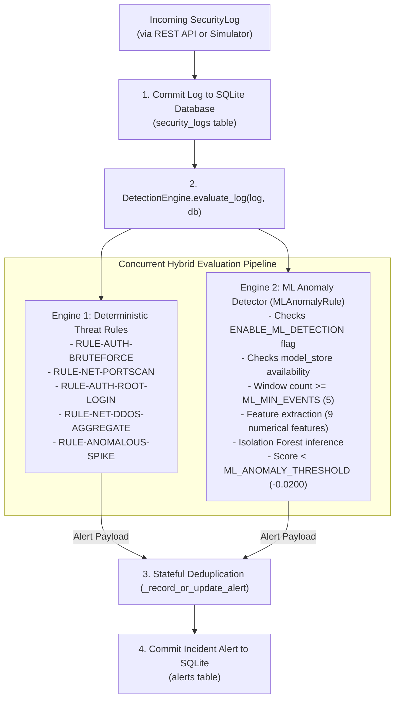

# Sentinel AI V1.5 — Hybrid Threat Detection Engine

## Overview & Architecture

**Sentinel AI V1.5** implements a **Hybrid Threat Detection Architecture** that unifies two complementary detection paradigms:
1. **Deterministic Rule Engine**: High-fidelity, deterministic signature rules evaluating precise threshold conditions over sliding temporal windows.
2. **Unsupervised Machine Learning Engine**: An Isolation Forest anomaly detector analyzing macroscopic statistical distributions of 9 canonical numerical features across an observation window.

Both engines evaluate security telemetry logs concurrently upon ingestion without competing or interfering with one another.



---

## 1. Engine 1: Five Deterministic Threat Rules

Deterministic rules identify known cyber attack patterns with deterministic thresholds configured via `.env` and `backend/app/core/config.py`:

| Rule ID | Rule Class | Default Window | Condition & Default Threshold | Severity |
|---|---|---|---|---|
| `RULE-AUTH-BRUTEFORCE` | `BruteForceRule` | 60 seconds | $\ge 5$ failed authentications (`AUTHENTICATION_FAILED`) from same `source_ip`. | **HIGH** |
| `RULE-NET-PORTSCAN` | `PortScanRule` | 30 seconds | Probes targeting $\ge 5$ distinct destination ports from same `source_ip`. | **MEDIUM** |
| `RULE-AUTH-ROOT-LOGIN` | `RootLoginRule` | Instantaneous | Successful authentication for `root` or `administrator` from non-private IP. *(Failed root attempts record as telemetry only)*. | **CRITICAL** |
| `RULE-NET-DDOS-AGGREGATE` | `DDoSAggregateRule` | 30 seconds | $\ge 20$ aggregate requests targeting one `destination_ip` from $\ge 3$ distinct `source_ip`s. | **CRITICAL** |
| `RULE-ANOMALOUS-SPIKE` | `AnomalousSpikeRule` | 60 seconds | Volumetric burst of $\ge 20$ requests from a single `source_ip`. | **MEDIUM** |

---

## 2. Engine 2: Unsupervised Machine Learning Pipeline

The machine learning engine (`MLAnomalyRule`) is implemented in `backend/app/detection/rules.py` and powered by the `backend/app/ml/` package.

### A. The 9 Canonical Numerical Features
Feature extraction (`backend/app/ml/features.py`) aggregates all security logs within the observation window into a 9-dimensional numerical vector:

| # | Feature Name | Description | Normal Baseline (Mean) |
|---|---|---|---|
| 1 | `total_events` | Total number of security logs in the observation window. | ~25.0 events |
| 2 | `failed_auth_count` | Count of `AUTHENTICATION_FAILED` logs. | ~0.24 events |
| 3 | `successful_auth_count` | Count of `AUTHENTICATION_SUCCESS` logs. | ~2.0 events |
| 4 | `unique_source_ips` | Number of distinct client IPs generating telemetry. | ~4.5 IPs |
| 5 | `unique_dest_ips` | Number of distinct destination host IPs targeted. | ~1.5 IPs |
| 6 | `unique_dest_ports` | Number of distinct destination ports probed. | ~2.0 ports |
| 7 | `event_frequency` | Telemetry event velocity (events / second). | ~0.75 req/s |
| 8 | `avg_time_interval` | Average time gap between consecutive event timestamps. | ~4.2 seconds |
| 9 | `network_traffic_volume` | Estimated or parsed total network byte volume. | ~15,000 bytes |

### B. Pure NumPy Preprocessing & Sanitization
Implemented in `backend/app/ml/preprocessing.py`:
- Converts feature dictionaries into 2D NumPy float arrays (`np.ndarray` with shape `(1, 9)`).
- Replaces `NaN`, `Inf`, and missing values with zero or feature-specific imputation defaults.
- Zero Pandas dependency, guaranteeing compatibility across Python 3.12 and strict Windows execution policies.

### C. Isolation Forest Model Configuration
The model wrapper `IsolationForestModel` (`backend/app/ml/model.py`) configures Scikit-learn's `IsolationForest`:
- `n_estimators`: 100 decision trees.
- `contamination`: 0.05 (assumed 5% anomaly margin in training distribution).
- `max_samples`: `'auto'` ($\min(256, n)$).
- `random_state`: 42 (ensures deterministic tree splits across runs).
- `n_jobs`: -1 (parallel CPU core computation).

---

## 3. Threshold Tuning & ML Evaluation

### Decision Boundary
The decision score $s(x)$ is calculated using `model.decision_function(X)`:
- Negative scores indicate points requiring fewer splits to isolate (outliers).
- Positive scores indicate points residing in dense normal feature clusters.

Centralized configuration in `.env`:
```ini
ENABLE_ML_DETECTION=True
ML_ANOMALY_THRESHOLD=-0.0200
ML_WINDOW_SECONDS=60
ML_MIN_EVENTS=5
```
An alert is raised when:
$$s(x) < \text{ML\_ANOMALY\_THRESHOLD} \quad (-0.0200)$$

### Pre-filter Guard
If the total number of security logs in the sliding window is less than `ML_MIN_EVENTS` (default: 5), the ML engine immediately returns `None` without running inference. This eliminates false alarms on sparse or intermittent telemetry.

---

## 4. Entity Attribution Policy

Unsupervised anomaly models evaluate macroscopic vectors rather than individual source IPs. To integrate seamlessly with Sentinel AI's alert lifecycle, `MLAnomalyRule` applies a deterministic entity attribution policy:

1. **Dominant Source IP**: If a single source IP accounts for $\ge 70\%$ of all events in the anomalous window, the alert is attributed directly to that IP:
   $$\text{source\_ip} = \text{dominant\_ip}$$
2. **Distributed Attack**: If multiple source IPs are involved (e.g., in a DDoS attack or botnet scan), the alert is attributed to:
   $$\text{source\_ip} = \text{"Distributed Sources"}$$
3. **Diffuse Telemetry**: If no single IP dominates and distinct sources are low, attribution defaults to:
   $$\text{source\_ip} = \text{"Global Telemetry Window"}$$

---

## 5. Stateful Alert Deduplication & Lifecycle

Both deterministic and ML alerts pass through `DetectionEngine._record_or_update_alert`:

1. **Active Incidents (`NEW` or `INVESTIGATING`)**:
   - Matches existing alert on `(rule_id, source_ip)`.
   - If found, increments `trigger_count` and updates `updated_at`. No duplicate row is inserted.
2. **Resolved Incidents (`RESOLVED` or `FALSE_POSITIVE`)**:
   - If a past incident was marked `RESOLVED` by an analyst and a fresh attack occurs, the engine opens a **new incident record** (`status="NEW"`).
3. **Fixed Severity Policy**:
   - ML alerts strictly maintain `severity="MEDIUM"` to acknowledge statistical uncertainty.

---

## 6. Concurrent Dual Alerts on Volumetric Bursts

Why does a synthetic `BRUTE_FORCE` or `DDOS_ATTACK` trigger two alerts simultaneously?

- **Deterministic Rule**: Matches the exact signature threshold (e.g., 5 failed logins within 60s from `198.51.100.42` $\to$ raises `RULE-AUTH-BRUTEFORCE`).
- **ML Anomaly Engine**: Detects that the macroscopic event frequency, failed auth count, and volume diverge drastically from normal baseline distributions $\to$ raises `RULE-ML-ANOMALY-IFOREST`.

This dual alerting is **expected and intended**:
- It demonstrates that Sentinel AI's hybrid system validates threats both through specific signature matching AND broader behavioral outlier isolation.
- Analysts can cross-reference deterministic alerts with statistical anomaly scores to confirm threat severity.

---

## 7. Failure Isolation & Graceful Degradation

The hybrid architecture enforces strict failure containment:

1. **Missing Model Artifact**:
   - If `isolation_forest.joblib` is absent from `backend/app/ml/saved_models/`, `MLAnomalyRule` logs an informational notice and remains safely **dormant**.
   - All 5 deterministic rules continue operating without interruption.
2. **Corrupted Model File**:
   - If the `.joblib` file cannot be deserialized or fails schema validation, the rule logs an error, swallows the exception, and disables ML inference.
3. **Runtime Database Rollback**:
   - `DetectionEngine.evaluate_log` wraps each rule execution in a `try ... except Exception:` block with an explicit `db.rollback()`. An unhandled error in one rule cannot prevent other rules from committing valid alerts.

---

## 8. Analyst Interpretation & Operational Limitations

> [!WARNING]
> **Operational Considerations for Security Analysts**:
> 1. **Statistical Outlier $\ne$ Malicious Intent**: An ML anomaly alert indicates that telemetry features deviated from the baseline distribution. Benign operations (such as high-volume patch distributions or automated stress testing) can trigger ML alerts.
> 2. **Non-Causal Attribution**: The Isolation Forest identifies outlier points in multi-dimensional space; it does not identify which specific feature was the "cause" of the anomaly.
> 3. **Anomaly Scores are Not Probabilities**: Raw decision scores represent continuous tree-isolation distances, not probabilistic confidence ratings.
> 4. **Stealth Attack Blind Spot**: Attackers conducting low-frequency probes (e.g., 1 failed login every 20 minutes) will blend into normal volume distributions and will not trigger ML anomalies. Such threats are detected deterministically once longer-term counters trigger.

