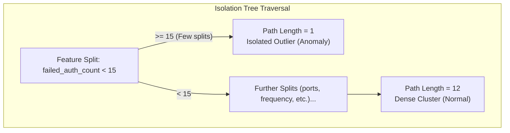
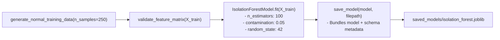

# Sentinel AI V1.5 — Isolation Forest Anomaly Detection (Phase 2)

## Overview

In **Phase 2 of Sentinel-AI V1.5**, we implement an independent, modular **Isolation Forest** anomaly detection engine using Scikit-learn (`sklearn.ensemble.IsolationForest`).

Phase 2 builds upon the 9 numerical features engineered in Phase 1. It provides model training, Joblib serialization, schema-validated model loading, and anomaly score prediction.

> [!IMPORTANT]
> **Phase 2 Scope & Live Alert Boundary**:
> The Isolation Forest model operates **independently**. It is NOT integrated into the live alert pipeline (`backend/app/detection/engine.py`), does NOT create database alerts, and does NOT alter existing deterministic detection rules. Live pipeline integration, threshold sensitivity calibration, and alert routing are reserved for Phase 3.

---

## 1. What Isolation Forest Does

Traditional anomaly detection algorithms construct profiles of "normal" behavior (e.g., density estimation, convex hulls, or distance to cluster centroids) and identify points that do not conform.

**Isolation Forest** reverses this paradigm: instead of modeling normal points, it **explicitly isolates anomalies**.

### Mechanism:
1. The algorithm builds an ensemble of completely random decision trees (**Isolation Trees** or *iTrees*).
2. At each tree node, an engineered feature is selected randomly from the 9 available features, and a split point is chosen uniformly at random between the feature's minimum and maximum values.
3. Because anomalous points have distinct or extreme feature values (e.g., 50 failed logins, 80 probed ports, or huge traffic spikes), they are isolated near the root of the tree in very few splits (short average path length $h(x)$).
4. Normal, frequent data points reside deep in dense clusters and require many more splits to isolate (long average path length).



---

## 2. Why Isolation Forest is Suitable for Sentinel-AI

1. **Unsupervised Operation**: Cyber threats evolve dynamically. Isolation Forest does not require expensive, labeled ground-truth datasets for training; it detects outliers based strictly on structural feature divergence.
2. **Computational Efficiency**: Isolation Forest operates with a linear time complexity:
   $$\mathcal{O}(t \cdot \psi \log \psi)$$
   where $t$ is the number of trees (`n_estimators=100`) and $\psi$ is the sub-sampling size (`max_samples='auto'`). It trains in fractions of a second on CPU cores.
3. **Multi-Dimensional Robustness**: It handles our 9 numerical features simultaneously without suffering from distance-metric distortions common to distance-based algorithms in higher dimensions.
4. **No Pandas Dependency**: Scikit-learn's Isolation Forest runs directly on 2D NumPy matrices (`np.ndarray`), ensuring 100% compatibility across Python 3.12 and strict Windows Application Control environments.

---

## 3. Synthetic Normal Training Data Generation

The module `backend/app/ml/training_data.py` generates reproducible baseline feature matrices representing typical corporate and host network activity.

### Normal Baseline Characteristics:
- **`total_events`**: 5 to 45 events per window (moderate normal traffic).
- **`failed_auth_count`**: 0 (80%), 1 (16%), or 2 (4%) accidental typos. Never $\ge 5$ (which would trigger brute-force alarms).
- **`successful_auth_count`**: 0 to 4 routine user sessions.
- **`unique_source_ips`**: 1 to 8 internal client workstations.
- **`unique_dest_ips`**: 1 to 2 destination servers (e.g. gateway, web server, internal DNS).
- **`unique_dest_ports`**: 1 to 3 standard destination ports (e.g. 80 HTTP, 443 HTTPS, 53 DNS). Never $\ge 5$ (which would trigger port scan alarms).
- **`event_frequency`**: 0.1 to 1.8 requests/second across a 20s–60s observation window.
- **`avg_time_interval`**: 0.5s to 15.0s between consecutive events.
- **`network_traffic_volume`**: 250 to 1,500 bytes per event.

> [!NOTE]
> **Operational Baseline Disclaimer**:
> Synthetic training data is a development baseline designed for deterministic testing and reproducible architecture verification. In production environments, baseline matrices should be collected from real, sanitized operational network telemetry during known benign maintenance windows.

---

## 4. How Model Training Works

Training is coordinated through `backend/app/ml/train.py`:



### Reproducibility & Hyperparameters:
Hyperparameters are centralized in `backend/app/ml/config.py`:
- `n_estimators`: 100 decision trees.
- `contamination`: 0.05 (assumed 5% outlier tolerance in baseline data).
- `random_state`: 42 (ensures identical trees across runs).
- `n_jobs`: -1 (parallel CPU tree construction).

---

## 5. Prediction Interface & Score Interpretation

Predictions can be evaluated via `IsolationForestModel.predict()`:

```python
from backend.app.ml.model_store import load_model

model = load_model()
results = model.predict([
    {"total_events": 15, "failed_auth_count": 0, "unique_dest_ports": 2},
    {"total_events": 80, "failed_auth_count": 45, "unique_dest_ports": 1}
])
```

### Result Schema:
```json
[
  {
    "prediction": "NORMAL",
    "is_anomaly": false,
    "raw_score": 0.142518,
    "anomaly_score": 0.3291,
    "interpretation": "raw_score represents Scikit-learn decision_function output: values >= 0.0 indicate normal baseline traffic, values < 0.0 indicate statistical anomalies. anomaly_score is normalized from 0.0 (most benign) to 1.0 (most anomalous). Note: A statistical anomaly indicates an unusual behavioral deviation and is not necessarily malicious."
  },
  {
    "prediction": "ANOMALY",
    "is_anomaly": true,
    "raw_score": -0.218491,
    "anomaly_score": 0.7488,
    "interpretation": "raw_score represents Scikit-learn decision_function output: values >= 0.0 indicate normal baseline traffic, values < 0.0 indicate statistical anomalies. anomaly_score is normalized from 0.0 (most benign) to 1.0 (most anomalous). Note: A statistical anomaly indicates an unusual behavioral deviation and is not necessarily malicious."
  }
]
```

### Metric Interpretation:
1. **`raw_score` (`decision_function`)**:
   - $\text{raw\_score} \ge 0.0$: Inlier (normal baseline behavior).
   - $\text{raw\_score} < 0.0$: Outlier (statistical anomaly).
   - More negative $\implies$ stronger statistical deviation.
2. **`anomaly_score` (Normalized)**:
   - Evaluated via continuous sigmoid mapping: $\frac{1}{1 + e^{5.0 \cdot \text{raw\_score}}}$
   - $0.0 \le \text{score} < 0.50$: Benign telemetry.
   - $\text{score} = 0.50$: Decision boundary.
   - $0.50 < \text{score} \le 1.0$: Statistically anomalous activity.

> [!CAUTION]
> **Anomaly $\neq$ Malicious Attack**:
> A statistical anomaly simply indicates that observed telemetry falls outside expected baseline variance. Legitimate administrative bulk actions, system backups, or sudden user traffic spikes can also produce anomalies. Phase 2 strictly marks anomalies without jumping to conclusions.

---

## 6. How to Train and Save a Model Manually

The training script is decoupled from backend startup and can be run on demand:

```bash
# Run manual training script using project virtual environment
.\venv\Scripts\python.exe -m backend.app.ml.train
```

Sample output:
```
================================================================
      SENTINEL-AI V1.5 - ISOLATION FOREST MODEL TRAINING        
================================================================
 * Model Type:         IsolationForest (Scikit-learn)
 * Model Version:      1.5.0
 * Training Samples:   250 normal baseline records
 * Features (9):       total_events, failed_auth_count, successful_auth_count, unique_source_ips...
 * Estimators:         100 trees
 * Contamination:      0.05
 * Random Seed:        42
 * Saved Artifact:     ...\backend\app\ml\saved_models\isolation_forest.joblib
 * Training Status:    SUCCESS
================================================================
```

---

## 7. Current Limitations & Why Phase 3 is Necessary

Phase 2 successfully creates a standalone ML engine. However, several critical operational aspects are deliberately deferred to **Phase 3**:

1. **Detection Engine Integration**: The live `DetectionEngine` currently evaluates only the 5 deterministic rules. In Phase 3, an ML detection rule (`IsolationForestRule` or hybrid correlation) will connect model scoring to the ingestion stream.
2. **Alert De-Duplication & Threshold Tuning**: Raw anomaly scores must be gated through alert dampening to prevent alert fatigue from noisy or transient spikes.
3. **Contamination Sensitivity**: Contamination is fixed at $0.05$. Phase 3 requires systematic benchmarking across ROC curves and false positive rates.
4. **Adaptive Baselines**: Operational networks experience diurnal patterns (day vs. night) which will require scheduled baseline retraining.

