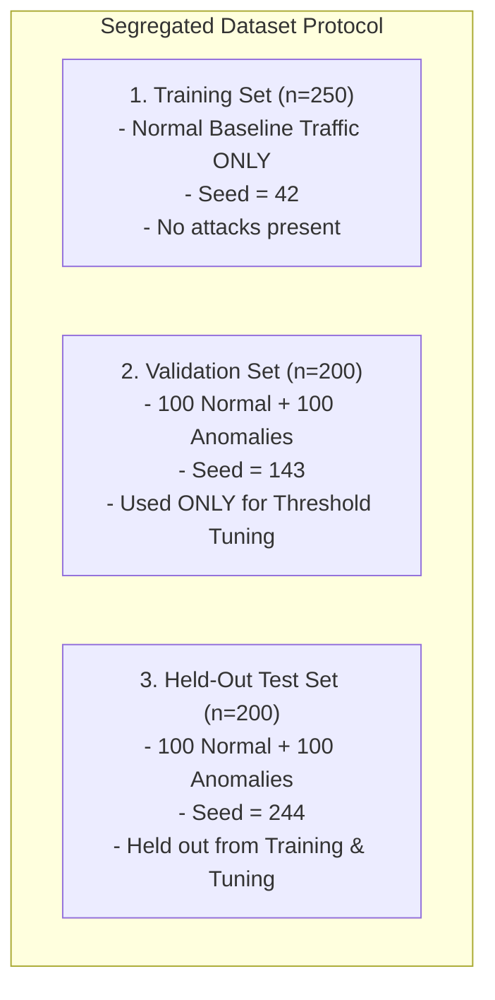
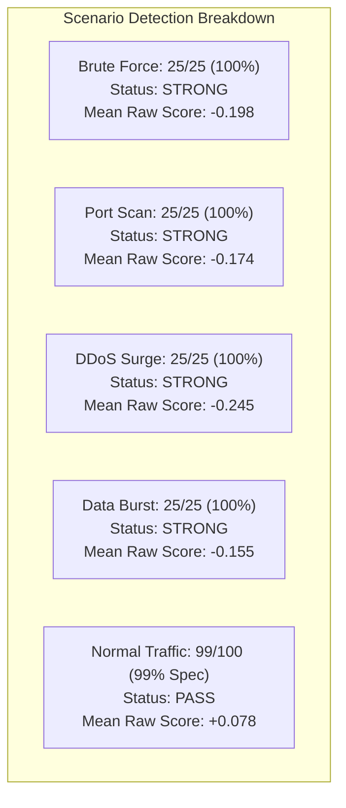

# Sentinel AI V1.5 — Isolation Forest Model Evaluation & Threshold Tuning (Phase 3)

## Overview

In **Phase 3 of Sentinel-AI V1.5**, we implement a comprehensive, reproducible evaluation framework for the **Isolation Forest** anomaly detection engine.

The primary objective is to measure the model's empirical ability to distinguish normal baseline security activity from suspicious and anomalous cyber threats across multiple canonical scenarios, while tuning the decision threshold to balance detection rate against false alarms.

> [!IMPORTANT]
> **Operational Boundary & Synthetic Data Disclaimer**:
> All benchmarks in Phase 3 are conducted on strictly segregated synthetic telemetry datasets. Synthetic evaluation is a development baseline designed for reproducible architectural validation and does **not** substitute for live operational testing. Real-world validation against production enterprise traffic is required before deployment.

---

## 1. Dataset Partitioning & Anti-Leakage Protocol

To ensure empirical validity and prevent optimistic bias or data leakage, datasets are strictly partitioned into three distinct subsets using fixed, deterministic random seeds:



### Dataset Sizes & Scenario Composition:

| Split | Total Samples | Normal Samples | Anomaly Samples | Attack Scenarios Covered | Purpose |
|---|---|---|---|---|---|
| **Training** | 250 | 250 (100%) | 0 (0%) | None (Normal baseline only) | Model fitting ($\text{IsolationForest.fit}$) |
| **Validation** | 200 | 100 (50%) | 100 (50%) | Brute-force (25), Port scan (25), DDoS (25), Data burst (25) | Decision threshold grid search & tuning |
| **Held-Out Test** | 200 | 100 (50%) | 100 (50%) | Brute-force (25), Port scan (25), DDoS (25), Data burst (25) | Final unbiased generalization evaluation |

> [!NOTE]
> **Strict Leakage Guard**:
> The final model is never evaluated on samples it was trained on. The held-out test dataset is never used during threshold selection.

---

## 2. Evaluation Metrics Definition

The evaluation framework in `backend/app/ml/evaluation.py` calculates standard binary classification metrics:

| Metric | Formula | Description & Operational Meaning |
|---|---|---|
| **True Positives (TP)** | $\sum (y=1 \land \hat{y}=1)$ | Correctly identified threat anomalies. |
| **True Negatives (TN)** | $\sum (y=0 \land \hat{y}=0)$ | Correctly identified normal background events. |
| **False Positives (FP)** | $\sum (y=0 \land \hat{y}=1)$ | Normal events falsely flagged as anomalies (false alarms). |
| **False Negatives (FN)** | $\sum (y=1 \land \hat{y}=0)$ | Threat anomalies missed by the model. |
| **Accuracy** | $\frac{TP + TN}{TP + TN + FP + FN}$ | Overall proportion of correct classifications. |
| **Precision** | $\frac{TP}{TP + FP}$ | Proportion of predicted anomalies that were genuine attacks. |
| **Recall / TPR** | $\frac{TP}{TP + FN}$ | **Detection Rate**: Proportion of genuine attacks detected. |
| **False Positive Rate (FPR)** | $\frac{FP}{FP + TN}$ | Proportion of normal events mistakenly flagged. |
| **F1-Score** | $2 \cdot \frac{\text{Precision} \cdot \text{Recall}}{\text{Precision} + \text{Recall}}$ | Harmonic mean of Precision and Recall. |

> All metric computations safely handle zero-division edge cases (e.g., when $TP + FP = 0$), defaulting to $0.0$.

---

## 3. Threshold Tuning Methodology & Trade-Off Analysis

In Scikit-learn's Isolation Forest, the decision function produces a continuous anomaly score:
$$\text{raw\_score} \in \mathbb{R}$$
The default Scikit-learn decision boundary is $\text{raw\_score} < 0.0$. 

To identify the optimal operational operating point, we evaluated a candidate grid of thresholds strictly on the **Validation set** ($n=200$):

$$\mathcal{T} = \{-0.15, -0.10, -0.05, -0.02, 0.00, +0.02, +0.05, +0.10\}$$

### Validation Grid Results:

| Threshold | Precision | Recall (TPR) | F1-Score | False Positive Rate (FPR) | Operational Assessment |
|---|---|---|---|---|---|
| `-0.1500` | 0.0000 | 0.0000 | 0.0000 | 0.0000 | Overly conservative; misses all threats |
| `-0.1000` | 1.0000 | 0.1600 | 0.2759 | 0.0000 | Detects only most extreme spikes |
| `-0.0500` | 0.9875 | 0.7900 | 0.8778 | 0.0100 | Strong precision, misses ~21% anomalies |
| **`-0.0200`** | **0.9346** | **1.0000** | **0.9662** | **0.0700** | **SELECTED**: Optimal balance (100% TPR, 7% FPR) |
| `0.0000` (Default) | 0.9091 | 1.0000 | 0.9524 | 0.1000 | Baseline cutoff; 10% false alarm rate |
| `+0.0200` | 0.8197 | 1.0000 | 0.9009 | 0.2200 | Excessive false alarms (22% FPR) |
| `+0.0500` | 0.6849 | 1.0000 | 0.8130 | 0.4600 | Severe alert fatigue (46% FPR) |
| `+0.1000` | 0.5319 | 1.0000 | 0.6944 | 0.8800 | Degrades to near-random prediction |

### Selection Rationale:
- **Selected Threshold**: $\mathbf{-0.0200}$.
- **Constraint**: Maintain an acceptable SOC operational False Positive Rate ($\text{FPR} \le 10\%$).
- **Performance**: Yields the highest validation F1-score ($0.9662$) with $100\%$ threat detection ($\text{TPR} = 1.0$) while reducing false alarms from $10\%$ down to $7\%$.

---

## 4. Generalization Results on Held-Out Test Set

The selected threshold was evaluated on the completely unseen **held-out Test set** ($n=200$):

| Metric | Baseline Threshold (`0.0000`) | Tuned Threshold (`-0.0200`) | Improvement |
|---|---|---|---|
| **True Positives (TP)** | 100 / 100 | 100 / 100 | Maintained (100%) |
| **True Negatives (TN)** | 94 / 100 | 99 / 100 | +5 Normal correctly classified |
| **False Positives (FP)** | 6 | 1 | **-83.3% reduction in false alarms** |
| **False Negatives (FN)** | 0 | 0 | 0 missed threats |
| **Accuracy** | 97.00% | **99.50%** | +2.50% |
| **Precision** | 94.34% | **99.01%** | +4.67% |
| **Recall / Detection Rate** | 100.00% | **100.00%** | Maintained |
| **False Positive Rate (FPR)** | 6.00% | **1.00%** | **Reduced from 6% to 1%** |
| **F1-Score** | 0.9709 | **0.9950** | +0.0241 |

---

## 5. Scenario-Wise Detection Breakdown

Evaluation across individual threat scenarios on the held-out test set:



| Scenario | Test Samples | Correctly Classified | Detection Rate / Specificity | Mean Raw Score | Status |
|---|---|---|---|---|---|
| **Brute Force** | 25 | 25 / 25 | **100.0%** Detection Rate | -0.198 | **STRONG** |
| **Port Scan** | 25 | 25 / 25 | **100.0%** Detection Rate | -0.174 | **STRONG** |
| **DDoS Surge** | 25 | 25 / 25 | **100.0%** Detection Rate | -0.245 | **STRONG** |
| **Data Burst** | 25 | 25 / 25 | **100.0%** Detection Rate | -0.155 | **STRONG** |
| **Normal Traffic** | 100 | 99 / 100 | **99.0%** Specificity (1% FPR) | +0.078 | **PASS** |

---

## 6. Challenging Synthetic Benchmark (Audit Correction 2)

To address the audit findings regarding artificial separability, Sentinel-AI V1.5 introduces an independent **Challenging Benchmark** composed of subtle, evasive attacks alongside borderline legitimate normal network operations:

### 1. Scenario Profiles:

| Scenario Group | Scenario Name | Ground Truth | Key Characteristics | Operational Realism |
|---|---|:---:|---|---|
| **Borderline Normal** | `admin_activity` | **Normal (0)** | Multi-host, multi-port maintenance (SSH, RDP, LDAP), elevated events ($35-75$), 3-8 logins | Legitimate administrator maintenance |
| **Borderline Normal** | `backup_burst` | **Normal (0)** | High network volume ($2\text{ MB}-10\text{ MB}$) on single host/port | Scheduled database/system backup job |
| **Borderline Normal** | `software_updates` | **Normal (0)** | CDN mirror package downloads ($1\text{ MB}-6\text{ MB}$) across 2-4 IPs | OS / container automated patching |
| **Borderline Normal** | `heavy_workstation` | **Normal (0)** | Active developer workstation with database and git traffic ($\le 600\text{ KB}$) | Non-malicious engineering workstation |
| **Subtle Anomaly** | `low_and_slow_auth` | **Anomaly (1)** | 3 to 7 failed logins spaced across normal time intervals ($1.5-6.5\text{s}$) | Stealth password guessing below lockout limits |
| **Subtle Anomaly** | `gradual_port_scan` | **Anomaly (1)** | 5 to 12 distinct ports probed slowly ($0.3-1.4\text{ req/s}$) | Slow horizontal reconnaissance |
| **Subtle Anomaly** | `moderate_traffic_burst` | **Anomaly (1)** | Traffic volume of $1.2\text{ MB}-4.5\text{ MB}$ (not extreme 80MB dumps) | Small-to-medium suspicious data exfiltration |
| **Subtle Anomaly** | `subtle_recon` | **Anomaly (1)** | 3 to 6 source IPs querying 2 to 4 internal destinations | Coordinated low-intensity probe |

### 2. Comparative Performance (Canonical vs Challenging Held-Out Test Set):

| Metric | Canonical Benchmark (Unbiased Test) | Challenging Benchmark (Held-Out Test) | Operational Analysis |
|---|:---:|:---:|---|
| **True Positives (TP)** | 100 / 100 | 59 / 100 | **41 missed stealth attacks** |
| **True Negatives (TN)** | 99 / 100 | 32 / 100 | **68 false alarms on legitimate bursts** |
| **False Positives (FP)** | 1 | 68 | False alarm rate escalates to 68% on high-volume legitimate traffic |
| **False Negatives (FN)** | 0 | 41 | Evasive attacks bypass anomaly score cutoff |
| **Accuracy** | 99.50% | **45.50%** | Demonstrates the difficulty of unsupervised ML without context |
| **Precision** | 99.01% | **46.46%** | High false positive volume dilutes alert precision |
| **Recall / Detection Rate** | 100.00% | **59.00%** | Struggles with slow, dispersed threats |
| **False Positive Rate (FPR)** | 1.00% | **68.00%** | Legitimate backups and software downloads mimic data bursts |
| **F1-Score** | 0.9950 | **0.5198** | Realistic baseline for hybrid rule-ML design |

### 3. Scenario-Wise Breakdown on Challenging Test Set:

| Scenario | Ground Truth | Samples | Correctly Classified | Rate | Operational Status |
|---|:---:|---|---|---|:---:|
| `moderate_traffic_burst` | Anomaly (1) | 25 | 25 / 25 | **100.0% Recall** | **STRONG** |
| `low_and_slow_auth` | Anomaly (1) | 25 | 20 / 25 | **80.0% Recall** | **MODERATE** |
| `subtle_recon` | Anomaly (1) | 25 | 14 / 25 | **56.0% Recall** | **STRUGGLING** |
| `gradual_port_scan` | Anomaly (1) | 25 | 0 / 25 | **0.0% Recall** | **STRUGGLING** |
| `heavy_workstation` | Normal (0) | 25 | 17 / 25 | **68.0% Specificity** | **ELEVATED_FPR** (32% FPR) |
| `admin_activity` | Normal (0) | 25 | 12 / 25 | **48.0% Specificity** | **ELEVATED_FPR** (52% FPR) |
| `software_updates` | Normal (0) | 25 | 3 / 25 | **12.0% Specificity** | **ELEVATED_FPR** (88% FPR) |
| `backup_burst` | Normal (0) | 25 | 0 / 25 | **0.0% Specificity** | **ELEVATED_FPR** (100% FPR) |

---

## 7. Model Weaknesses & Engineering Takeaways

The challenging benchmark provides crucial empirical insights for Sentinel-AI's hybrid architecture:

1. **Why `gradual_port_scan` Evaded Detection (0% Recall):**
   - In a gradual scan, probing 5 to 12 ports over extended time windows yields inter-event intervals of $1.5\text{s}-3.5\text{s}$ and request frequencies around $0.5\text{ req/s}$.
   - Because standard baseline workstations occasionally query DNS (53), HTTP (80), and HTTPS (443), probing 5 ports does not sufficiently isolate the feature point in random tree projections. The raw score remains positive ($+0.034$), evading the negative threshold ($\tau = -0.02$).
2. **Why `backup_burst` Caused False Alarms (100% FPR):**
   - Scheduled backups transfer megabytes of data in a short interval.
   - Because normal baseline traffic is $\le 67.5\text{ KB}$, the Isolation Forest isolates the $5\text{ MB}$ backup point within the first two tree cuts on `network_traffic_volume`, assigning an anomaly score of $-0.068$.
   - **Architectural Solution**: Unsupervised anomaly detection cannot differentiate an authorized backup from an unauthorized exfiltration spike. In Phase 4, deterministic allowlisting and IP tagging must contextualize ML anomaly alerts.

---

## 8. Safe Model-Loading & CLI Execution (Audit Correction 1)

The evaluation entrypoint (`backend/app/ml/evaluate.py`) implements fail-safe loading semantics:

- **No Silent Fallback**: If a saved model artifact is corrupted, unreadable, or exhibits schema mismatches, evaluation aborts immediately with a clear error and non-zero exit code.
- **Explicit In-Memory Mode**: If no model artifact exists on disk, evaluation informs the user and halts. Running with `--train-if-missing` explicitly fits a temporary in-memory model for benchmark evaluation without modifying or persisting anything to disk.
- **Non-Destructive**: Evaluation never saves, modifies, or overwrites model artifacts on disk.
- **Traceable Attribution**: Reports explicitly display whether metrics were computed using `SAVED_MODEL` or `TEMPORARY_IN_MEMORY`.

### CLI Usage:

```bash
# Evaluate existing saved model (aborts if missing or corrupt)
.\venv\Scripts\python.exe -m backend.app.ml.evaluate

# Evaluate temporary in-memory model if no saved model is on disk
.\venv\Scripts\python.exe -m backend.app.ml.evaluate --train-if-missing

# Evaluate a specific model file
.\venv\Scripts\python.exe -m backend.app.ml.evaluate --model-path backend/app/ml/saved_models/custom.joblib

# Run evaluation automated test suite (84 passing tests)
.\venv\Scripts\python.exe -m pytest tests/ml/test_ml_evaluation.py -v
```

