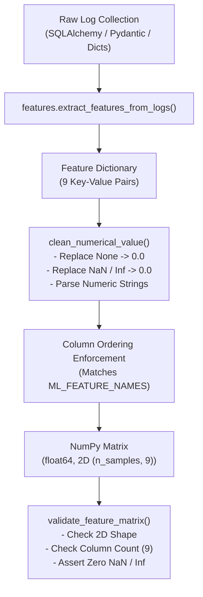

# Sentinel AI V1.5 — Machine Learning Feature Engineering (Phase 1)

## Overview

In **Phase 1 of Sentinel-AI V1.5**, we lay the groundwork for future unsupervised anomaly detection using **Isolation Forest** (`sklearn.ensemble.IsolationForest`). 

This phase is strictly dedicated to **feature extraction and preprocessing**. No machine-learning models are trained, loaded, or integrated into the live alert pipeline yet. All five existing deterministic detection rules continue to operate unaltered.

> [!NOTE]
> **NumPy-Only Architecture**:
> To ensure seamless cross-platform execution and avoid Windows Application Control policy blocks on compiled extension DLLs, the pipeline relies exclusively on **NumPy arrays** and **standard Python data structures** without Pandas. Scikit-learn estimators operate directly on 2D NumPy matrices.

---

## 1. Why Feature Engineering is Needed

Raw security telemetry stored in SQLite or ingested via API endpoints consists of semi-structured records containing:
- Textual messages (`"Failed password attempt for root"`)
- Categorical strings (`"AUTHENTICATION_FAILED"`, `"TCP"`)
- IP strings (`"198.51.100.42"`)
- ISO-8601 timestamps (`"2026-11-09T17:00:00Z"`)
- Variable JSON payloads (`raw_data`)

Machine learning algorithms—specifically tree-based partition models like Isolation Forest—cannot process raw text or relational database models directly. They require a structured, 2-dimensional numerical matrix:
$$\mathbf{X} \in \mathbb{R}^{n \times m}$$
where $n$ represents the number of observation windows/samples and $m$ represents the number of engineered numerical features.

Feature engineering bridges this gap by transforming raw discrete events into quantitative behavioral indicators that capture attack patterns such as authentication floods, port scanning sweeps, traffic spikes, and distributed DDoS activity.

---

## 2. Feature Definitions & Security Relevance

The ML module defines **9 canonical numerical features** in `backend/app/ml/config.py`:

| # | Feature Name | Data Type | Description | Security Threat Detected |
|---|---|---|---|---|
| 1 | `total_events` | `float64` | Total count of security logs observed within the sample window. | Volumetric floods, request surges, quiet scanning |
| 2 | `failed_auth_count` | `float64` | Count of failed authentication events (`AUTHENTICATION_FAILED`, `AUTH_FAILURE`, `LOGIN_FAILED`). | Brute-force attacks, credential stuffing, password spraying |
| 3 | `successful_auth_count` | `float64` | Count of successful logins / administrative authentications (`AUTHENTICATION_SUCCESS`, `LOGIN_SUCCESS`, `ROOT_LOGIN`). | Account takeover, credential compromise, unauthorized remote root access |
| 4 | `unique_source_ips` | `float64` | Distinct count of non-null originating IP addresses. | Distributed botnets (DDoS) vs. single-source attacks |
| 5 | `unique_dest_ips` | `float64` | Distinct count of non-null target IP addresses. | Internal lateral movement, subnet reconnaissance |
| 6 | `unique_dest_ports` | `float64` | Distinct count of destination ports probed (0–65535). | Horizontal and vertical port scanning |
| 7 | `event_frequency` | `float64` | Events per second over the time window ($\text{events} / \Delta t$). | Automated high-speed tooling vs. human activity |
| 8 | `avg_time_interval` | `float64` | Mean time interval between consecutive events ($\Delta t / (k - 1)$). | Periodic beaconing, rapid burst attacks |
| 9 | `network_traffic_volume` | `float64` | Aggregated payload size/bytes extracted from telemetry metadata (`raw_data`). | Data exfiltration, bandwidth saturation |

> [!NOTE]
> **Adherence to Existing Database Schema**:
> The `SecurityLog` database table and `LogCreate` schema do not have a dedicated `bytes` column. In accordance with project constraints, no schema migrations or new database columns were invented. Instead, `network_traffic_volume` safely inspects the existing `raw_data` JSON field (looking for keys such as `bytes`, `size`, or `packet_size`). If omitted or benign, it defaults to `0.0`.

---

## 3. Preprocessing Pipeline Architecture

The preprocessing pipeline in `backend/app/ml/preprocessing.py` guarantees that raw feature dictionaries are transformed into model-ready numerical formats without risk of runtime exceptions:



### Preprocessing Safeguards:
1. **Column Ordering Consistency**: Feature dictionaries can have arbitrary key orders or missing keys. The preprocessor strictly indexes keys using `ML_FEATURE_NAMES`, guaranteeing consistent column positions for future estimators.
2. **Missing Value Imputation**: Any missing optional field or omitted key is safely imputed with `0.0`.
3. **Invalid Value Neutralization**: Scikit-learn estimators raise `ValueError` when encountering `NaN`, `+Inf`, or `-Inf`. The preprocessor sanitizes all values using `clean_numerical_value()` and `np.nan_to_num()`.
4. **Validation Constraints**: `validate_feature_matrix()` verifies dimensionality, column width, and numerical finiteness before returning.
5. **No Pandas Dependency**: Scikit-learn models natively consume 2D NumPy arrays (`np.ndarray`). Eliminating Pandas eliminates DLL loading constraints, minimizes memory footprint, and maximizes execution performance.

---

## 4. Why This Phase Does Not Yet Perform Anomaly Detection

Phase 1 deliberately restricts scope to **feature engineering and data preparation**:

1. **Isolation of Concerns**: Data engineering must be verified and tested independently of model performance. Separating feature extraction from inference ensures reliable unit tests and reproducible baseline inputs.
2. **Deterministic Stability**: The five existing deterministic detection rules (`BruteForceRule`, `PortScanRule`, `RootLoginRule`, `DDoSAggregateRule`, `AnomalousSpikeRule`) protect the system. Introducing model training prematurely could introduce false positives or destabilize existing tests.
3. **Hyperparameter Tuning & Baselines**: Isolation Forest requires tuning parameters (such as `contamination`, `n_estimators`, and normal traffic baselines). This requires dedicated synthetic training corpora and evaluation metrics planned for Phase 2.
4. **Zero Model Overhead**: In Phase 1, `backend/app/ml/config.py` specifies configuration structures (`IsolationForestConfig`), but **no model is trained, loaded into memory, or persisted to disk**.

---

## 5. Usage Example

```python
from backend.app.ml.features import extract_features_from_logs
from backend.app.ml.preprocessing import (
    preprocess_feature_batch,
    preprocess_to_records,
    validate_feature_matrix
)

# 1. Extract features from a batch of logs
log_batch = [
    {"source_ip": "198.51.100.42", "event_type": "AUTHENTICATION_FAILED", "destination_port": 22},
    {"source_ip": "198.51.100.42", "event_type": "AUTHENTICATION_FAILED", "destination_port": 22},
]
feature_dict = extract_features_from_logs(log_batch)

# 2. Preprocess to 2D NumPy array with guaranteed column ordering
X = preprocess_feature_batch([feature_dict])
print(X.shape)  # (1, 9)
print(X.dtype)  # float64

# 3. Validate matrix constraints before passing to scikit-learn
validate_feature_matrix(X)  # Returns True

# 4. Optional: inspect features as standard Python records
records = preprocess_to_records([feature_dict])
print(records[0]["failed_auth_count"])  # 2.0
```
